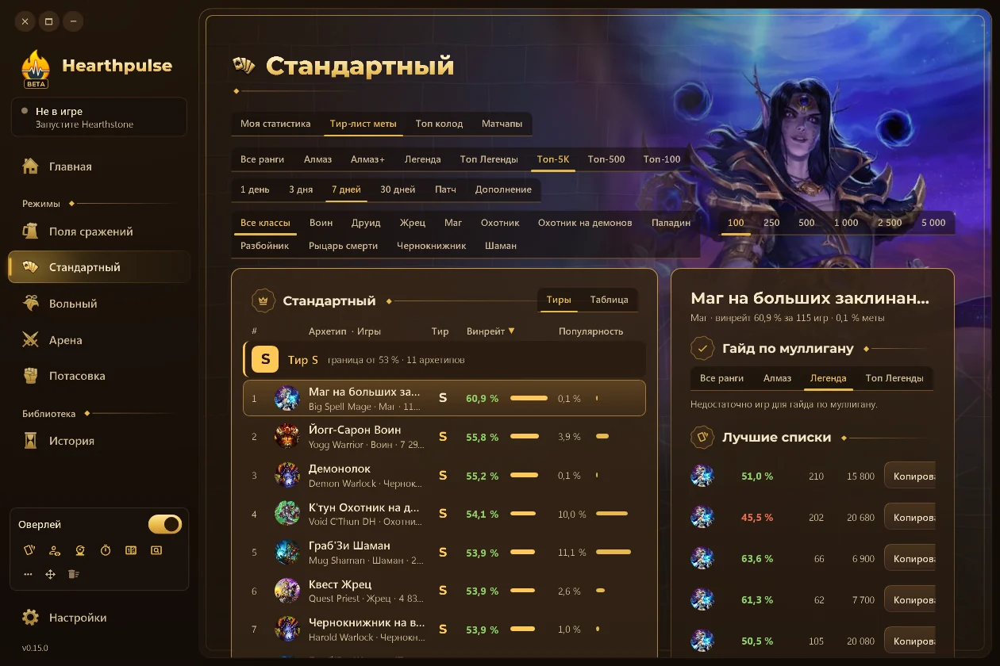
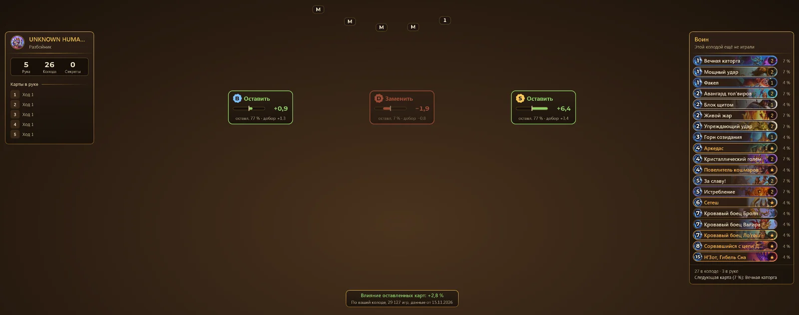

# Hearthpulse

**Ваш напарник в Hearthstone: трекер колоды, советник Полей сражений и оверлей прямо поверх игры.**

Меньше гаданий, больше побед: Hearthpulse подсказывает, что оставить в муллигане, кого взять на Полях сражений,
чем вас могут удивить и какие колоды сейчас на вершине меты.

[Сайт](https://hearthpulse.net) · [Что нового](installer/RELEASE_NOTES.md) · [Все версии](https://github.com/Zulut30/Hearthpulse-Companion/releases)

## Почему Hearthpulse

- 🎯 **Подсказки там, где вы играете.** Оверлей поверх Hearthstone: колода, муллиган, пул карт для Раскопки,
  счётчики, шансы в бою. Панели можно двигать мышью прямо во время игры.
- 📊 **Мета под ваш ранг, а не только для Легенды.** Тир-листы, лучшие списки и матчапы с фильтрами по рангу,
  периоду и классу. Гайд по муллигану подстраивается под вашу точную колоду.
- 🍺 **Поля сражений на новом уровне.** Тиры героев, сборок, безделушек и карт по MMR, шансы в бою с диапазоном
  урона, таблица лобби, доска напарника в Дуэтах.
- 💎 **Ваша коллекция и пыль.** Hearthpulse видит, какие колоды из топа вы уже можете собрать и сколько пыли
  не хватает. Фильтр «Могу собрать» за один клик.
- 🎬 **Каждая игра остаётся с вами.** История с повторами ход за ходом, избранное, импорт, ссылка на повтор
  для друзей, экспорт в CSV и картинки, которыми не стыдно поделиться.
- 🔒 **Честно и безопасно.** Приложение только читает. Оно никогда не меняет игру, не нажимает за вас кнопки
  и не показывает скрытое: руку и колоду соперника вы не увидите.

## Оверлей в игре

**Муллиган.** Какие карты оставить, насколько каждая меняет винрейт и что ещё лежит в колоде,
с шансом вытянуть каждую карту:

**Поля сражений.** Оценка героев на выборе, карточка соперника с его последним столом и таблица лобби
с исходами ваших боёв:

А ещё:

- вероятная колода соперника по мете, с отмеченными сыгранными картами;
- кладбище обеих сторон и урон, который каждый стол может нанести герою;
- пул карт для Раскопки и случайных эффектов, связанные карты рядом с той, что под мышью;
- секреты соперника и игровые счётчики для Стандарта, Арены и Полей сражений;
- помощник драфта Арены (бета, включается в настройках).

## Статистика и мета

| Карта во всех подробностях | Поля сражений по MMR |
|---|---|
|  |  |
| Доля в колодах, винрейт, когда карту вытянули и сыграли, муллиган и архетипы, в которых она играет. | Тиры героев, сборок, безделушек и карт для Соло и Дуэтов, ваша личная статистика героев. |

- **Моя статистика:** винрейт, ранг и MMR во времени, места на Полях сражений, лучшие колоды и герои.
- **Арена и Потасовка:** награды за каждый забег, Арена и Подземная арена отдельно, лучшие классы недели в Потасовке.
- **Переезд без потерь:** игры и колоды из Hearthstone Deck Tracker и Firestone переносятся в вашу историю и библиотеку колод.

## Для стримеров и тех, кто любит делиться

- Окна для захвата в OBS: колода, лобби, шансы в бою, итог сессии.
- Режим стримера скрывает лишнее с экрана.
- Итог сессии и картинки колод для соцсетей, таймкоды для YouTube.
- Статус в Discord (выключен по умолчанию).

## Ваш стиль

Тринадцать тем от «Таверны» до «Меха», свой акцент, шрифт, плотность и размер интерфейса, галерея тем
с живым предпросмотром и поиск по настройкам. Русский и английский интерфейс.

## Установка

| Система | Что скачать |
|---|---|
| **Windows 10/11** | `Hearthpulse-Setup-<версия>-win-x64.exe`, или `Portable`-архив без установки |
| **macOS** (Intel и Apple Silicon) | `.dmg`, `.pkg` или `.zip` для `x64` / `arm64` |
| **Linux** (x64 и arm64) | `.deb`, `.rpm`, `.AppImage` или `.tar.gz` |

Все файлы лежат в [последнем релизе](https://github.com/Zulut30/Hearthpulse-Companion/releases/latest).
При первом запуске Hearthpulse сам включит нужные журналы Hearthstone, после этого игру нужно один раз перезапустить.

Если система предупреждает при запуске

- **Windows:** установщик пока без цифровой подписи, поэтому SmartScreen может предупредить.
  Нажмите «Подробнее» → «Выполнить в любом случае».
- **macOS:** приложение пока не нотаризовано. В первый раз откройте его через правый клик → «Открыть».
- **Linux:** пакеты не обновляются сами. Скачайте новую версию и установите поверх.

**Обновления на Windows приходят сами.** Каждое обновление сверяется с контрольной суммой релиза и подписью
проекта. Если установка не удалась, приложение вернёт прежнюю версию. С версии 0.15.0 скачиваются только
изменившиеся файлы.

## Приватность

- История игр и настройки хранятся на вашем компьютере. Коллекция и пыль никуда не отправляются.
- Чтобы считать рейтинг, коллекцию и данные лобби, Hearthpulse на Windows читает память игры.
  Только чтение: в игру он ничего не записывает.
- Анонимная статистика игр по умолчанию отправляется в общую статистику Hearthpulse: без имени, BattleTag и аккаунта.
  Выключается одним переключателем в «Настройки → Данные». Полный список того, что отправляется, показан
  в приложении.
- Отчёты об ошибках выключены по умолчанию и уходят только с вашего согласия.

## Обратная связь

Hearthpulse в бете. Нашли ошибку или есть идея? Напишите через [сайт](https://hearthpulse.net) или создайте
[issue](https://github.com/Zulut30/Hearthpulse-Companion/issues).

---

Hearthpulse — проприетарное программное обеспечение, все права защищены ([LICENSE](LICENSE)).
Сторонние данные и компоненты перечислены в [THIRD-PARTY-NOTICES.txt](THIRD-PARTY-NOTICES.txt).
Hearthpulse не связан с Blizzard Entertainment и не одобрен ею. Hearthstone — товарный знак Blizzard Entertainment, Inc.
Используйте на свой риск.
