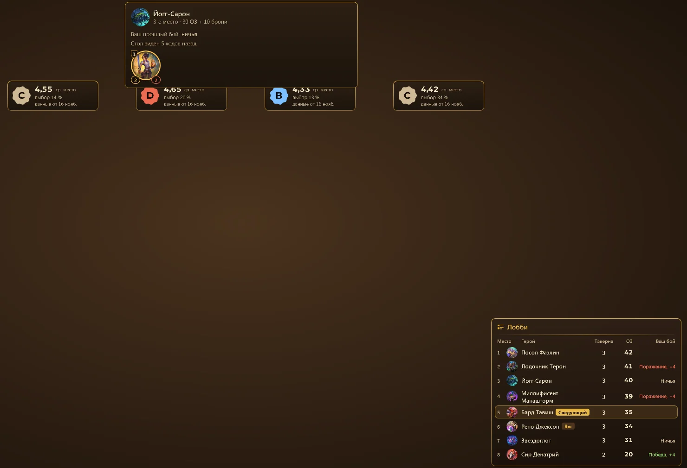
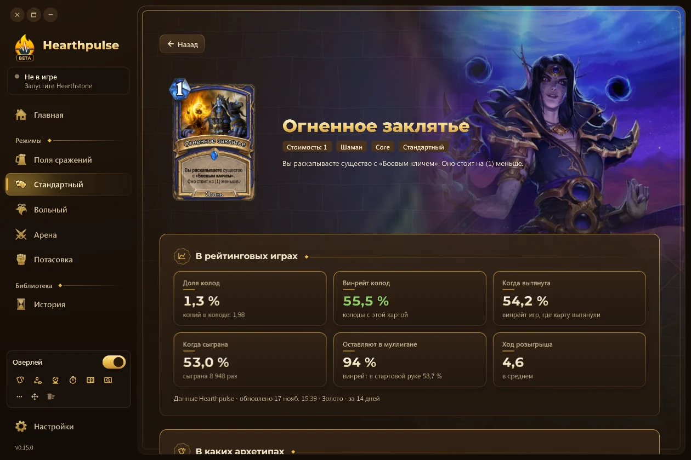
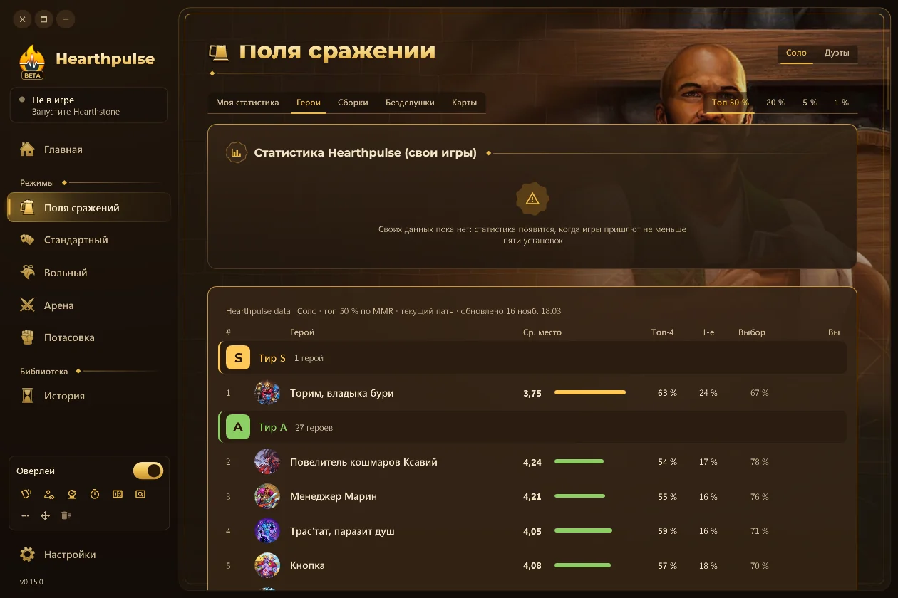

<div align="center">

**English** | [Русский](README.ru.md)


# Hearthpulse — Hearthstone Deck Tracker & Overlay

**A Hearthstone deck tracker and in-game overlay with a mulligan guide, Battlegrounds combat odds, meta tiers for your rank and your own game history.**

[](https://github.com/Zulut30/Hearthpulse-Companion/releases/latest)
[](https://github.com/Zulut30/Hearthpulse-Companion/releases)
[](https://github.com/Zulut30/Hearthpulse-Companion/actions/workflows/ci.yml)
[](LICENSE)
[](#install)
[](https://dotnet.microsoft.com/)


[Website](https://hearthpulse.net) · [Download](https://github.com/Zulut30/Hearthpulse-Companion/releases/latest) · [Release notes](installer/RELEASE_NOTES.md) · [Report a bug](https://github.com/Zulut30/Hearthpulse-Companion/issues)

</div>


Hearthpulse reads the Hearthstone log while you play and shows your deck, mulligan advice, Battlegrounds combat
odds and game counters right over the game. After the game it keeps the match in your history as a turn-by-turn
replay. It runs on Windows, macOS and Linux, in English and Russian.

## Features

- 🎯 **In-game overlay.** Deck tracker, mulligan advice, card pool for Discover and random effects, counters, the
  opponent's Secrets and Battlegrounds combat odds. Unlock the panels to move them with the mouse during a game.
- 📊 **Meta for your rank.** Tier lists, top decks and matchups filtered by rank, period and class. The mulligan
  guide matches your exact decklist.
- 🍺 **Battlegrounds.** Hero, comp, trinket and card tiers by MMR for Solo and Duos, win/tie/loss odds with damage
  ranges, a lobby table with your fight results, the Duos partner's board.
- 💎 **Collection and dust.** See which top decks you can already build and how much dust is missing. The
  collection stays on your PC.
- 🎬 **History and replays.** Every game is a turn-by-turn replay: star it, import one, share a link, export
  History to CSV.
- 🔒 **Read-only.** Hearthpulse never changes the game, never clicks for you and never shows hidden information:
  you do not see the opponent's hand or deck.

## In-game overlay

**Mulligan guide.** Which cards to keep, how each one changes the win rate, and what is still in your deck with the
chance to draw each card:


**Battlegrounds.** Hero ratings on the hero pick, an opponent card with their last board, and a lobby table with
the results of your fights:



Also on the overlay:

- the opponent's likely deck from the meta, with played cards marked;
- a graveyard for both sides and the damage each board can deal to the hero;
- the card pool for Discover and random effects, and related cards next to the card under the mouse;
- the opponent's Secrets and game counters for Standard, Arena and Battlegrounds;
- an Arena draft helper (beta, off by default).

## Battlegrounds combat simulator

Before each fight Hearthpulse simulates it from both boards and shows the chances to win, tie and lose, with the
damage range. A quick first result appears at once; a longer run then replaces it and goes into your history.
When a board has a card whose effect the simulator does not model yet, the fight is marked "not simulated" instead
of showing a guess.

The simulator is written from game data, without code from other simulators. Its accuracy is checked on real
fights from game logs, and coverage grows with each patch: [docs/bg-combat-sim.md](docs/bg-combat-sim.md).

## Hearthstone stats and meta

| Every card in detail | Battlegrounds by MMR |
|---|---|
|  |  |
| Play rate, win rate when drawn and played, mulligan and the archetypes that run it. | Hero, comp, trinket and card tiers for Solo and Duos, and your own hero stats. |

- **My Stats:** win rate, rank and MMR over time, Battlegrounds placements, your best decks and heroes.
- **Arena and Tavern Brawl:** rewards for each run, Arena and Underground Arena counted apart, the best classes of
  the week's Brawl.
- **Move over from Hearthstone Deck Tracker or Firestone:** bring your past games and decks into History, My Stats
  and your deck library ([docs/migration.md](docs/migration.md)).

## For streamers

- OBS capture windows: deck, lobby, combat odds, session recap.
- Streamer mode hides what should stay off screen.
- Session recap and deck pictures to post, YouTube timestamps.
- Discord status (off by default).

## Your look

Thirteen themes from Tavern to Mech, your own accent, font, density and interface size, a theme gallery with live
preview and settings search. English and Russian interface.

## Install

| System | Download |
|---|---|
| **Windows 10/11** | `Hearthpulse-Setup-<version>-win-x64.exe`, or the `Portable` archive |
| **macOS** (Intel and Apple Silicon) | `.dmg`, `.pkg` or `.zip` for `x64` / `arm64` |
| **Linux** (x64 and arm64) | `.deb`, `.rpm`, `.AppImage` or `.tar.gz` |

All files are in the [latest release](https://github.com/Zulut30/Hearthpulse-Companion/releases/latest). On the
first start Hearthpulse turns on the Hearthstone logs it needs; restart the game once after that.

<details>
<summary>If the system warns you on start</summary>

- **Windows:** the installer is not code-signed yet, so SmartScreen may warn you. Click "More info" → "Run anyway".
- **macOS:** the app is not notarized yet. The first time, open it with right-click → "Open".
- **Linux:** packages do not update themselves. Download the new version and install it over the old one.

</details>

**Updates on Windows arrive on their own.** Each update is checked against the release checksum and the project's
signature. If an install fails, the app puts the previous version back. Since 0.15.0 only the changed files are
downloaded.

## Privacy

- Game history and settings stay on your computer. The collection and dust never leave it.
- On Windows Hearthpulse reads the game's memory to get your rank, collection and lobby data. It only reads:
  nothing is written into the game.
- Anonymous game records go to Hearthpulse statistics by default, without your name, BattleTag or account. Turn
  this off in **Settings → Data**; the switch lists every field that is sent.
- When you sign in with a hearthpulse.net account, finished games go to your profile on the site. A switch in the
  **Settings → Hearthpulse account** turns this off.
- Crash reports are off by default and are sent only when you agree.

Details: [docs/game-stats.md](docs/game-stats.md), [docs/source-capture.md](docs/source-capture.md),
[docs/profile-upload.md](docs/profile-upload.md), [docs/crash-reports.md](docs/crash-reports.md).

## Build from source

You need the [.NET 10 SDK](https://dotnet.microsoft.com/download). The source is published for reading and
development; see [License](#license) for what it allows.

```sh
dotnet restore Hearthpulse.slnx --source https://api.nuget.org/v3/index.json
dotnet build Hearthpulse.slnx
dotnet run --project src/Hearthpulse.App       # WPF app, Windows
dotnet run --project src/Hearthpulse.Desktop   # Avalonia app, Windows/macOS/Linux
dotnet test tests/Hearthpulse.Tests
```

| Project | What it is |
|---|---|
| `src/Hearthpulse.Core` | Log parsing, trackers, counters, combat simulator, history, data clients |
| `src/Hearthpulse.App` | WPF app for Windows (what the Windows installer ships) |
| `src/Hearthpulse.UI` + `src/Hearthpulse.Desktop` | Avalonia app for Windows, macOS and Linux |
| `src/Hearthpulse.Presentation` | View models shared by both UIs |

Feature specs and data contracts: [docs/README.md](docs/README.md).

## Contributing

Hearthpulse is in beta. Bug reports and ideas are welcome in
[issues](https://github.com/Zulut30/Hearthpulse-Companion/issues) or through the [website](https://hearthpulse.net).
Before sending code, open an issue first: the licence does not allow publishing changed copies without permission.

## License

Hearthpulse is proprietary software, all rights reserved: see [LICENSE](LICENSE). You may install and use official
releases for personal, non-commercial use; publishing the source grants no further rights. Portions are based on
HeartLens by Dev-NotAqua and are used with the author's permission.

## Credits

- Card data and card art: [HearthstoneJSON](https://hearthstonejson.com/).
- Battlegrounds tiers and card text: [hsbg.cards](https://hsbg.cards/).
- Meta, mulligan and Battlegrounds numbers: Hearthpulse data.
- Icons: [game-icons.net](https://game-icons.net/) (CC BY 3.0) and Material Design Icons; fonts and other
  components are listed in [THIRD-PARTY-NOTICES.txt](THIRD-PARTY-NOTICES.txt).

---

<sub>Hearthpulse is a third-party program, not affiliated with, endorsed or sponsored by Blizzard Entertainment.
Hearthstone and Battlegrounds are trademarks or registered trademarks of Blizzard Entertainment, Inc.
Hearthstone Deck Tracker and Firestone are named only to describe import compatibility. Use at your own risk.</sub>
