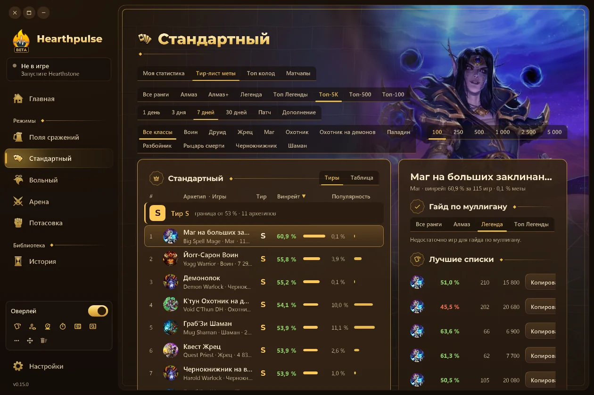
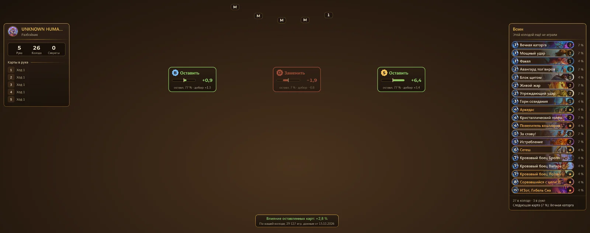
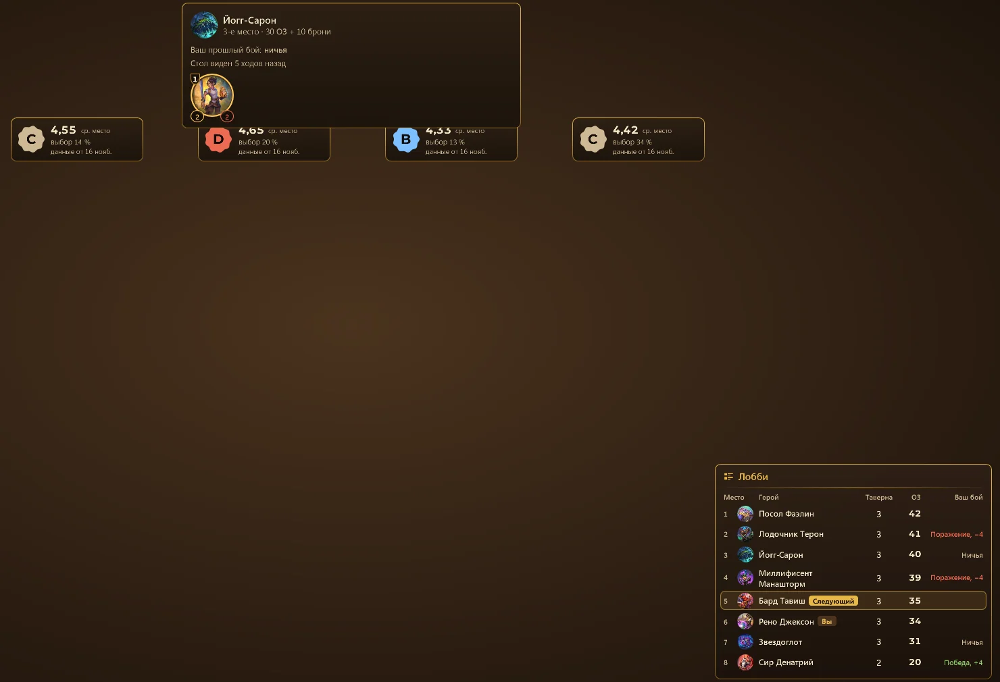
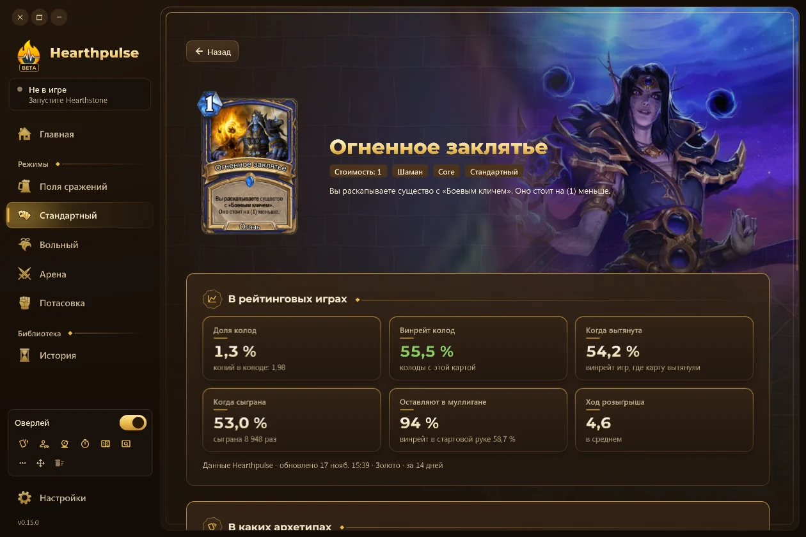
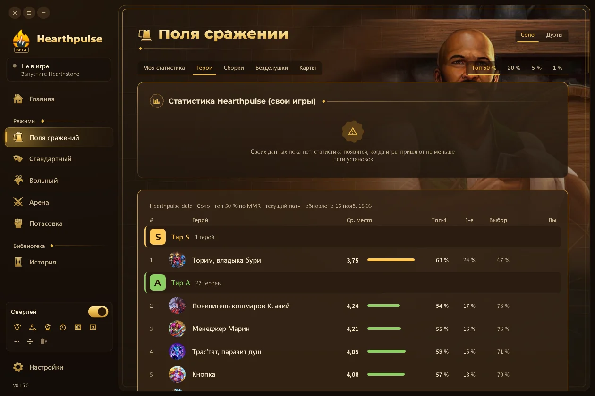

<div align="center">

[English](README.md) | **Русский**


# Hearthpulse — трекер колоды и оверлей для Hearthstone

**Трекер колоды и оверлей для Hearthstone: гайд по муллигану, шансы в бою на Полях сражений, мета под ваш ранг и история ваших игр.**

[](https://github.com/Zulut30/Hearthpulse-Companion/releases/latest)
[](https://github.com/Zulut30/Hearthpulse-Companion/releases)
[](https://github.com/Zulut30/Hearthpulse-Companion/actions/workflows/ci.yml)
[](LICENSE)
[](#установка)
[](https://dotnet.microsoft.com/)


[Сайт](https://hearthpulse.net) · [Скачать](https://github.com/Zulut30/Hearthpulse-Companion/releases/latest) · [Что нового](installer/RELEASE_NOTES.md) · [Сообщить об ошибке](https://github.com/Zulut30/Hearthpulse-Companion/issues)

</div>



Hearthpulse читает журнал Hearthstone во время игры и показывает поверх неё вашу колоду, советы по муллигану,
шансы в бою на Полях сражений и игровые счётчики. После игры матч остаётся в истории как повтор ход за ходом.
Работает на Windows, macOS и Linux, на русском и английском.

## Возможности

- 🎯 **Оверлей в игре.** Трекер колоды, советы по муллигану, пул карт для Раскопки и случайных эффектов, счётчики,
  секреты соперника и шансы в бою на Полях сражений. Разблокируйте панели, чтобы двигать их мышью прямо в игре.
- 📊 **Мета под ваш ранг.** Тир-листы, лучшие колоды и матчапы с фильтрами по рангу, периоду и классу. Гайд по
  муллигану подстраивается под вашу точную колоду.
- 🍺 **Поля сражений.** Тиры героев, сборок, безделушек и карт по MMR для Соло и Дуэтов, шансы на победу, ничью и
  поражение с диапазоном урона, таблица лобби с исходами ваших боёв, доска напарника в Дуэтах.
- 💎 **Коллекция и пыль.** Видно, какие колоды из топа вы уже можете собрать и сколько пыли не хватает. Коллекция
  остаётся на вашем компьютере.
- 🎬 **История и повторы.** Каждая игра — повтор ход за ходом: отметьте её, импортируйте чужую, поделитесь ссылкой,
  выгрузите историю в CSV.
- 🔒 **Только чтение.** Hearthpulse не меняет игру, не нажимает за вас кнопки и не показывает скрытое: руку и колоду
  соперника вы не увидите.

## Оверлей в игре

**Гайд по муллигану.** Какие карты оставить, насколько каждая меняет винрейт и что ещё лежит в колоде, с шансом
вытянуть каждую карту:



**Поля сражений.** Оценка героев на выборе, карточка соперника с его последним столом и таблица лобби с исходами
ваших боёв:



А ещё на оверлее:

- вероятная колода соперника по мете, с отмеченными сыгранными картами;
- кладбище обеих сторон и урон, который каждый стол может нанести герою;
- пул карт для Раскопки и случайных эффектов, связанные карты рядом с той, что под мышью;
- секреты соперника и игровые счётчики для Стандарта, Арены и Полей сражений;
- помощник драфта Арены (бета, выключен по умолчанию).

## Поля сражений: симулятор боя

Перед каждым боем Hearthpulse проигрывает его по обеим доскам и показывает шансы на победу, ничью и поражение
с диапазоном урона. Быстрый первый результат появляется сразу, затем его заменяет более долгий расчёт, и он же
попадает в историю. Если на доске есть карта, эффект которой симулятор пока не моделирует, бой помечается
«не симулирован», а не показывает догадку.

Симулятор написан по данным игры, без кода других симуляторов. Точность проверяется на реальных боях из журналов
игры, покрытие растёт с каждым патчем: [docs/bg-combat-sim.md](docs/bg-combat-sim.md).

## Статистика и мета Hearthstone

| Карта во всех подробностях | Поля сражений по MMR |
|---|---|
|  |  |
| Доля в колодах, винрейт, когда карту вытянули и сыграли, муллиган и архетипы, в которых она играет. | Тиры героев, сборок, безделушек и карт для Соло и Дуэтов, ваша статистика героев. |

- **Моя статистика:** винрейт, ранг и MMR во времени, места на Полях сражений, лучшие колоды и герои.
- **Арена и Потасовка:** награды за каждый забег, Арена и Подземная арена отдельно, лучшие классы недели в Потасовке.
- **Переезд с Hearthstone Deck Tracker или Firestone:** прошлые игры и колоды переносятся в историю, «Мою
  статистику» и библиотеку колод ([docs/migration.md](docs/migration.md)).

## Для стримеров

- Окна для захвата в OBS: колода, лобби, шансы в бою, итог сессии.
- Режим стримера скрывает лишнее с экрана.
- Итог сессии и картинки колод для соцсетей, таймкоды для YouTube.
- Статус в Discord (выключен по умолчанию).

## Ваш стиль

Тринадцать тем от «Таверны» до «Меха», свой акцент, шрифт, плотность и размер интерфейса, галерея тем с живым
предпросмотром и поиск по настройкам. Русский и английский интерфейс.

## Установка

| Система | Что скачать |
|---|---|
| **Windows 10/11** | `Hearthpulse-Setup-<версия>-win-x64.exe` или архив `Portable` |
| **macOS** (Intel и Apple Silicon) | `.dmg`, `.pkg` или `.zip` для `x64` / `arm64` |
| **Linux** (x64 и arm64) | `.deb`, `.rpm`, `.AppImage` или `.tar.gz` |

Все файлы лежат в [последнем релизе](https://github.com/Zulut30/Hearthpulse-Companion/releases/latest). При первом
запуске Hearthpulse сам включит нужные журналы Hearthstone, после этого игру нужно один раз перезапустить.

<details>
<summary>Если система предупреждает при запуске</summary>

- **Windows:** установщик пока без цифровой подписи, поэтому SmartScreen может предупредить. Нажмите «Подробнее» →
  «Выполнить в любом случае».
- **macOS:** приложение пока не нотаризовано. В первый раз откройте его через правый клик → «Открыть».
- **Linux:** пакеты не обновляются сами. Скачайте новую версию и установите поверх.

</details>

**Обновления на Windows приходят сами.** Каждое обновление сверяется с контрольной суммой релиза и подписью
проекта. Если установка не удалась, приложение вернёт прежнюю версию. С версии 0.15.0 скачиваются только
изменившиеся файлы.

## Приватность

- История игр и настройки хранятся на вашем компьютере. Коллекция и пыль никуда не отправляются.
- На Windows Hearthpulse читает память игры, чтобы узнать ранг, коллекцию и данные лобби. Только чтение: в игру
  он ничего не записывает.
- Анонимные записи игр по умолчанию уходят в статистику Hearthpulse: без имени, BattleTag и аккаунта. Выключается
  в **«Настройки → Данные»**; у переключателя перечислено каждое отправляемое поле.
- Если вы вошли с аккаунтом hearthpulse.net, завершённые игры уходят в ваш профиль на сайте. Выключается
  в **«Настройки → Аккаунт Hearthpulse»**.
- Отчёты об ошибках выключены по умолчанию и уходят только с вашего согласия.

Подробнее: [docs/game-stats.md](docs/game-stats.md), [docs/source-capture.md](docs/source-capture.md),
[docs/profile-upload.md](docs/profile-upload.md), [docs/crash-reports.md](docs/crash-reports.md).

## Сборка из исходников

Нужен [.NET 10 SDK](https://dotnet.microsoft.com/download). Исходники опубликованы только для ознакомления; что
разрешено, сказано в разделе [Лицензия](#лицензия).

```sh
dotnet restore Hearthpulse.slnx --source https://api.nuget.org/v3/index.json
dotnet build Hearthpulse.slnx
dotnet run --project src/Hearthpulse.App       # приложение WPF, Windows
dotnet run --project src/Hearthpulse.Desktop   # приложение Avalonia, Windows/macOS/Linux
dotnet test tests/Hearthpulse.Tests
```

| Проект | Что это |
|---|---|
| `src/Hearthpulse.Core` | Разбор журнала, трекеры, счётчики, симулятор боя, история, клиенты данных |
| `src/Hearthpulse.App` | Приложение WPF для Windows (его ставит установщик Windows) |
| `src/Hearthpulse.UI` + `src/Hearthpulse.Desktop` | Приложение Avalonia для Windows, macOS и Linux |
| `src/Hearthpulse.Presentation` | Общие модели представления обоих интерфейсов |

Спецификации функций и контракты данных: [docs/README.md](docs/README.md).

## Участие

Hearthpulse в бете. Ошибки и идеи присылайте в [issues](https://github.com/Zulut30/Hearthpulse-Companion/issues)
или через [сайт](https://hearthpulse.net). Прежде чем присылать код, откройте issue: лицензия не разрешает
публиковать изменённые копии без разрешения.

## Лицензия

Hearthpulse — проприетарное программное обеспечение, все права защищены; юридически действует лицензионное
соглашение на английском в [LICENSE](LICENSE), установщик Windows просит его принять. Официальные релизы с GitHub
или [hearthpulse.net](https://hearthpulse.net) можно устанавливать и использовать на своих устройствах, а приложение
и оверлей — показывать в стримах, видео и на скриншотах, в том числе монетизированных. Копировать, изменять,
распространять и перезаливать приложение, установщики или исходники, заниматься обратной разработкой, обучать на
коде и данных модели ИИ или делать на их основе конкурирующий продукт нельзя. Открытые исходники — только для
ознакомления и лицензии не дают; присланные issues, идеи и pull request можно использовать без обязательств. Часть
кода основана на HeartLens от Dev-NotAqua и используется с разрешения автора.

## Благодарности

- Данные и изображения карт: [HearthstoneJSON](https://hearthstonejson.com/).
- Тиры и тексты карт Полей сражений: [hsbg.cards](https://hsbg.cards/).
- Мета, муллиган и числа Полей сражений: данные Hearthpulse.
- Иконки: [game-icons.net](https://game-icons.net/) (CC BY 3.0) и Material Design Icons; шрифты и другие
  компоненты перечислены в [THIRD-PARTY-NOTICES.txt](THIRD-PARTY-NOTICES.txt).

---

<sub>Hearthpulse — сторонняя программа, не связанная с Blizzard Entertainment и не одобренная и не спонсируемая ею.
Hearthstone и Battlegrounds — товарные знаки или зарегистрированные товарные знаки Blizzard Entertainment, Inc.
Hearthstone Deck Tracker и Firestone упомянуты только для описания совместимости импорта. Используйте на свой риск.</sub>
